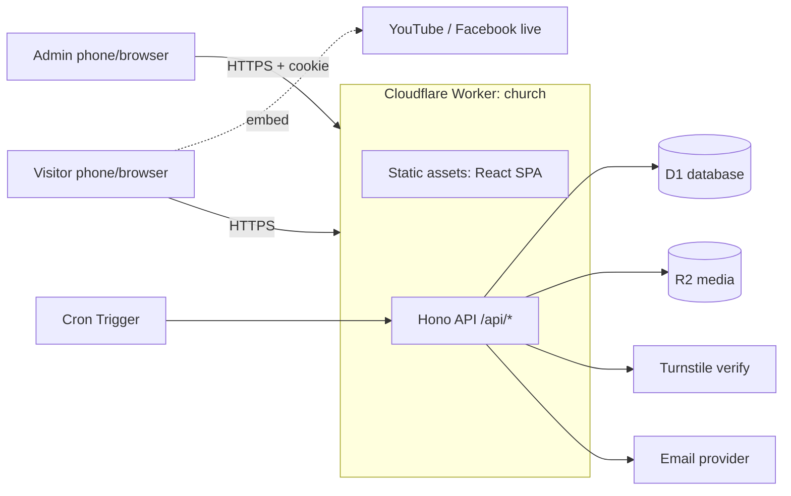

# Architecture

> [!warning] Stack pending confirmation
> The target stack below is **proposed**. The Rentspot project's stack was not available when this was written. If Rentspot uses something different, update [[14-Decisions-and-Open-Questions#ADR-001]] first; the rest of the docs follow from it.
> The repo is already deployed on Cloudflare Workers (`church.paul-amancioiii.workers.dev`), which is why the proposal stays on Cloudflare.

## Principles

1. Frontend and API are separate layers joined only by HTTP + shared types.
2. One deployable Worker serves static assets and `/api/*` → same origin, no CORS, one deploy.
3. All content is data. All writes go through validated, audited API calls.
4. Read-heavy public endpoints are cacheable; admin endpoints are never cached.

## Target stack

| Concern | Choice | Why |
|---|---|---|
| UI | React 18 + Vite + Tailwind + shadcn/ui + wouter | Already in repo |
| Server state | TanStack Query | Already in repo, currently unused |
| API framework | **Hono** on Cloudflare Workers | Tiny, TypeScript-first, runs on Workers (Express does not run natively there) |
| Validation | **Zod** in `shared/` | One schema for form + API |
| Database | **Cloudflare D1** (SQLite) via **Drizzle ORM** | Free-tier friendly, same ORM already in repo (dialect changes from Postgres) |
| File storage | **Cloudflare R2** | Images for announcements, ministries, events |
| Bot protection | **Cloudflare Turnstile** | Free CAPTCHA alternative |
| Rate limiting | Workers rate-limit binding, D1 counter as fallback | Per-client throttling |
| Email | Provider interface; **Resend** default | Needs a verified sending domain |
| Scheduled jobs | **Cron Triggers** | Daily devotion, digests, retention |
| Auth | Signed JWT in `HttpOnly; Secure; SameSite=Lax` cookie, PBKDF2 via WebCrypto | No Node-only libs (bcrypt) on Workers |
| Tests | Vitest + Workers pool, Testing Library, Playwright | See [[09-Test-Cases]] |

> [!todo] Phase 1 spike
> Before building, verify current Cloudflare details (rate-limit binding availability, `assets.run_worker_first`, D1 limits, Cron syntax) against Cloudflare's docs. Product details change; this note records intent, not guarantees.

## System diagram



## Request flow

1. Browser requests `/` → Worker returns SPA assets.
2. SPA calls `GET /api/public/home` → Worker reads D1, filters by visibility rules, returns JSON (cacheable ~60 s).
3. Admin logs in → `Set-Cookie` session → SPA calls `/api/admin/*` with `credentials: include`.
4. Writes validate with shared Zod schema → DB → audit log row → response.

## Routing

`wrangler.jsonc` (target):

```jsonc
{
  "name": "church",
  "main": "api/index.ts",
  "compatibility_date": "2026-08-15",
  "assets": {
    "directory": "dist/public",
    "not_found_handling": "single-page-application",
    "run_worker_first": ["/api/*"]
  },
  "d1_databases": [{ "binding": "DB", "database_name": "church-db", "database_id": "<id>" }],
  "r2_buckets": [{ "binding": "MEDIA", "bucket_name": "church-media" }],
  "triggers": { "crons": ["0 21 * * *"] }
}
```

`0 21 * * *` = 21:00 UTC = **05:00 Asia/Manila** (the daily devotion send).

## Repository layout (target)

```
client/              React app (unchanged location)
api/                 Hono app: routes/, services/, db/, middleware/, jobs/
shared/              Zod schemas, enums, types used by client AND api
migrations/          SQL migrations generated by drizzle-kit
docs/                This vault
tests/               api/, e2e/
wrangler.jsonc
```

The existing `server/` (Express) is removed in Phase 1.

## Cross-cutting design

### Time

- DB stores UTC instants as integer epoch ms.
- Schedules ("every Sunday 9:00") are stored as local wall-clock time + rule, interpreted in `church_profile.timezone`.
- The API returns both the rule and `next_occurrence_at` (UTC ISO) so the client never computes recurrence.

### Soft delete

Every table has `deleted_at`. A single repository helper adds `WHERE deleted_at IS NULL` by default; admin lists accept `includeDeleted=true`. See [[10-Code-Guide#Soft delete]].

### Visibility computed at read time

Announcement, event and service visibility is evaluated in SQL on every read. No job flips flags, so a missed cron can never leave stale content live.

### Aggregated home endpoint

`GET /api/public/home` returns church profile, services, ministries, events, live announcements (first page), and stream state in one response → fewer round trips on mobile networks.

### Error model

All errors: `{ "error": { "code": "VALIDATION_ERROR", "message": "…", "details": {…} } }`. See [[05-API-Reference#Conventions]].

### Authorization

Hono middleware: `requireAuth` → `requireRole([...])`. Each admin route declares its roles explicitly. Matrix in [[02-Requirements-Spec#Roles and access]].

### Live stream

v1 embeds an external stream (YouTube Live). Admin stores the source and an `is_live` toggle. An embed host allowlist prevents arbitrary iframes. Native broadcasting is deferred ([[14-Decisions-and-Open-Questions#ADR-005]]).

### Email

`EmailProvider` interface (`send({to, subject, html, text, headers})`). Implementations: Resend, and a `ConsoleProvider` for local dev. Outbox table makes sends retryable and auditable. Sending requires a **verified domain**; `*.workers.dev` cannot send mail ([[14-Decisions-and-Open-Questions#OQ-06]]).

### Observability

Workers observability is already enabled in `wrangler.jsonc`. Logs must never contain prayer request text, emails, or tokens ([[11-Security-and-Abuse-Prevention]]).

## Environments

| Env | Where | DB | Purpose |
|---|---|---|---|
| local | `wrangler dev` / Vite | local D1 (SQLite file) | Development |
| preview | Worker version URL | separate D1 | PR review (optional) |
| production | `church.<account>.workers.dev` → custom domain later | prod D1 | Live |

## Migration path from the current scaffold

See [[13-Current-State-Gap-Analysis]] and Phase 1 in [[06-Development-Phases]].
