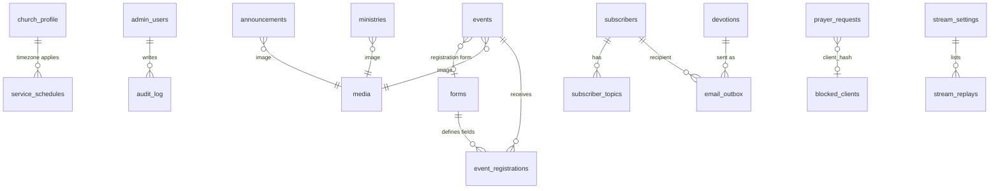

# Data Model

Database: Cloudflare D1 (SQLite) via Drizzle. Source of truth in code: `shared/schema.ts` (Drizzle tables + Zod insert/select schemas). This note is the human-readable version.

## Conventions

| Rule | Detail |
|---|---|
| IDs | `TEXT` UUID (`crypto.randomUUID()`) |
| Timestamps | `INTEGER` epoch **milliseconds, UTC** (`created_at`, `updated_at`, `deleted_at`, …) |
| Soft delete | Every table: `deleted_at INTEGER NULL`, `deleted_by TEXT NULL`. **Never `DELETE`.** |
| Audit columns | `created_at`, `updated_at`, `created_by`, `updated_by` on admin-managed tables |
| Booleans | `INTEGER 0/1` |
| Enums | `TEXT` + `CHECK` constraint, mirrored by Zod enum in `shared/` |
| JSON | `TEXT` holding JSON, validated by Zod on write |
| Times of day | `TEXT 'HH:MM'` 24-hour, interpreted in church timezone |

## ER diagram



## Tables

### `church_profile` (singleton, `id = 1`)

| Column | Type | Notes |
|---|---|---|
| id | INTEGER PK | always 1 |
| name | TEXT NOT NULL | **configurable** ("Hope" seed) |
| tagline | TEXT | |
| mission | TEXT | |
| vision | TEXT | |
| about | TEXT | welcome paragraph(s) |
| founded_year | INTEGER | drives *years serving* |
| members_count | INTEGER | manually maintained |
| address | TEXT | multi-line |
| map_url | TEXT | Google Maps link |
| phone | TEXT | |
| email | TEXT | public contact email |
| timezone | TEXT | default `Asia/Manila` |
| logo_media_id | TEXT FK → media | |
| hero_media_id | TEXT FK → media | |
| social_links | TEXT JSON | `{facebook, youtube, instagram}` |
| crisis_message | TEXT | shown after prayer request submit |
| updated_at / updated_by | | |

Computed in API (not stored): `years_serving`.

### `admin_users`

| Column | Type | Notes |
|---|---|---|
| id | TEXT PK | |
| email | TEXT UNIQUE NOT NULL | lower-cased |
| display_name | TEXT | |
| password_hash | TEXT | PBKDF2 hash + salt + iterations |
| role | TEXT | `super_admin`, `admin`, `editor`, `prayer_team` |
| is_active | INTEGER | |
| failed_attempts | INTEGER | |
| locked_until | INTEGER NULL | |
| last_login_at | INTEGER NULL | |
| totp_secret | TEXT NULL | phase later |
| created_at, deleted_at | | soft delete = deactivate |

### `announcements`

| Column | Type | Notes |
|---|---|---|
| id | TEXT PK | |
| title | TEXT NOT NULL | |
| summary | TEXT | short description |
| type | TEXT | `article` / `image` / `video` |
| body | TEXT | article text (plain text or limited markdown) |
| media_id | TEXT FK NULL | image |
| video_url | TEXT NULL | allowlisted host |
| scope | TEXT | `daily` / `weekly` / `monthly` |
| is_published | INTEGER | false = draft |
| is_pinned | INTEGER | |
| effective_at | INTEGER NOT NULL | start of public visibility |
| expires_at | INTEGER NULL | end of public visibility, `> effective_at` |
| audit columns, deleted_at | | |

Indexes: `(is_published, effective_at, expires_at)`, `(scope)`, `(deleted_at)`.

Derived `status` (API): `draft`, `scheduled`, `live`, `expired`, `deleted`. Rule in [[02-Requirements-Spec#Visibility truth table]].

### `service_schedules`

| Column | Type | Notes |
|---|---|---|
| id | TEXT PK | |
| name | TEXT NOT NULL | "Sunday Morning Service" |
| description | TEXT | |
| audience | TEXT | "All ages welcome" |
| icon | TEXT | lucide icon name |
| recurrence_type | TEXT | `weekly` / `monthly_nth` |
| day_of_week | INTEGER | 0 = Sunday … 6 = Saturday |
| week_of_month | INTEGER NULL | 1–4, or `-1` = last. Required when `monthly_nth` |
| start_time | TEXT | `'09:00'` |
| end_time | TEXT | `'12:00'` |
| effective_from | INTEGER NULL | optional season window |
| effective_to | INTEGER NULL | |
| is_streamed | INTEGER | used for live countdown |
| is_active | INTEGER | |
| sort_order | INTEGER | |
| audit columns, deleted_at | | |

Related: `service_exceptions(id, service_id FK, date TEXT 'YYYY-MM-DD', reason, deleted_at)` for cancelled occurrences.

**Seed rows**

| name | recurrence | day | start–end |
|---|---|---|---|
| Sunday Morning Service | weekly | 0 | 09:00–12:00 |
| Sunday Afternoon Service | weekly | 0 | 15:00–18:00 |

**Example admin-added row:** Corporate Prayer Meeting — `monthly_nth`, `day_of_week=2` (Tuesday), `week_of_month=3`, `19:00–21:00`.

### `ministries` (Get involved)

| Column | Type | Notes |
|---|---|---|
| id, name, description | | |
| media_id | TEXT FK NULL | image |
| leader_name | TEXT NULL | |
| contact | TEXT NULL | email/phone/link |
| is_active, sort_order | | |
| audit columns, deleted_at | | |

Seed: Life Groups, Shepherding, Music Ministry, Sound System, Ushering Ministry.

### `events`

| Column | Type | Notes |
|---|---|---|
| id, title, description | | |
| category | TEXT | Worship, Prayer, Fellowship, Outreach… |
| location | TEXT | |
| starts_at / ends_at | INTEGER | UTC |
| media_id | TEXT FK NULL | |
| requires_registration | INTEGER | |
| form_id | TEXT FK NULL | **required** when `requires_registration = 1` and published |
| registration_opens_at / closes_at | INTEGER NULL | |
| capacity | INTEGER NULL | |
| is_published | INTEGER | |
| audit columns, deleted_at | | |

### `forms` (registration form templates)

| Column | Type | Notes |
|---|---|---|
| id, name, description | | |
| fields | TEXT JSON | ordered array, see below |
| confirmation_message | TEXT | shown after submit |
| audit columns, deleted_at | | |

`fields` item:

```json
{
  "key": "adults",
  "label": "Number of adults",
  "type": "number",
  "required": true,
  "helpText": "Including yourself",
  "options": [],
  "min": 1, "max": 10
}
```

Supported `type`: `text`, `textarea`, `email`, `phone`, `number`, `select`, `radio`, `checkbox`, `date`. Keys are unique per form and immutable once responses exist (labels may change).

> [!tip] Why JSON, not a field table?
> "Do whatever is easier" — a JSON definition makes the builder, validator and CSV export simple, and lets forms be cloned. See [[14-Decisions-and-Open-Questions#ADR-004]].

### `event_registrations`

| Column | Type | Notes |
|---|---|---|
| id | TEXT PK | |
| event_id | FK | |
| form_id | FK | form at time of submit |
| form_snapshot | TEXT JSON | copy of the field definitions, so old responses stay readable |
| answers | TEXT JSON | `{key: value}` |
| contact_name, contact_email | TEXT NULL | extracted from fields of type email / flagged name field |
| status | TEXT | `confirmed`, `cancelled`, `waitlist` |
| client_hash | TEXT | daily-rotating hash for throttling |
| created_at, deleted_at | | |

Unique (soft-aware): `(event_id, lower(contact_email))` where email present and not deleted.

### `prayer_requests`

| Column | Type | Notes |
|---|---|---|
| id | TEXT PK | |
| body | TEXT NOT NULL | 10–1000 chars, plain text |
| category | TEXT NULL | healing, family, guidance, thanksgiving, other |
| display_name | TEXT NULL | optional; blank = anonymous |
| share_with_congregation | INTEGER | default 0 |
| status | TEXT | `new`, `reviewed`, `relayed`, `archived` |
| screening | TEXT | `clean`, `quarantined`, `urgent`, `spam` |
| screening_reasons | TEXT JSON | e.g. `["contains_link"]` |
| client_hash | TEXT | HMAC(ip, daily salt) |
| handled_by | TEXT FK NULL | |
| relayed_at | INTEGER NULL | |
| created_at, deleted_at | | |

> [!danger] Never stored
> IP address, user agent, email, phone. Never logged: `body`.

### `blocked_clients`

| Column | Type |
|---|---|
| id, client_hash, reason, blocked_by, expires_at, created_at, deleted_at | |

### `subscribers`

| Column | Type | Notes |
|---|---|---|
| id | TEXT PK | |
| email | TEXT UNIQUE (lower-cased) | |
| name | TEXT NULL | |
| status | TEXT | `pending`, `confirmed`, `unsubscribed`, `suppressed` |
| confirm_token_hash | TEXT | hash only, token emailed |
| manage_token_hash | TEXT | for unsubscribe/manage links |
| consent_at | INTEGER | when they asked |
| confirmed_at | INTEGER NULL | |
| unsubscribed_at | INTEGER NULL | |
| created_at, deleted_at | | |

`subscriber_topics(subscriber_id, topic)` where topic ∈ `daily_devotion`, `bible_reading`, `announcements`, `events`. Unsubscribing sets `status = unsubscribed` (a soft state; row kept to honour the opt-out).

### `devotions`

| Column | Type | Notes |
|---|---|---|
| id, title | | |
| publish_date | TEXT `'YYYY-MM-DD'` | church-local date |
| scripture_reference | TEXT | "John 3:16-21" |
| body | TEXT | |
| reading_references | TEXT JSON | for Bible reading topic |
| is_published | INTEGER | |
| audit columns, deleted_at | | |

### `email_outbox`

| Column | Type |
|---|---|
| id, kind (`confirm`, `devotion`, `digest`, `registration`, `prayer_digest`), subscriber_id NULL, to_email, subject, html, text | |
| status (`queued`, `sent`, `failed`), attempts, last_error, scheduled_for, sent_at, created_at | |

### `stream_settings` (singleton) and `stream_replays`

`stream_settings`: `platform` (`youtube`/`facebook`/`other`), `source_type` (`channel`/`video`/`url`), `source_value`, `is_live`, `title`, `live_since`, `updated_by`.
`stream_replays`: `id, title, url, aired_on, media_id NULL, sort_order, deleted_at`.

### `media`

`id, r2_key, mime_type, size_bytes, width, height, alt_text, uploaded_by, created_at, deleted_at`.

### `audit_log`

`id, actor_id, action (create/update/delete/restore/status/login…), entity, entity_id, summary, created_at`. Never contains prayer text or secrets.

## Retention defaults (configurable)

| Data | Default |
|---|---|
| Prayer requests | Auto-archive 90 days, purge 12 months (audited) |
| Event registrations | Keep 24 months after event |
| Unsubscribed subscribers | Keep row (opt-out proof) 24 months, then purge |
| Email outbox | 90 days |
| Audit log | 24 months |

These are proposals — see [[14-Decisions-and-Open-Questions#OQ-09]].

## Seed data

`api/db/seed.ts` creates: church profile ("Hope", placeholder address/phone/email, founded year placeholder), two default services, five ministries, empty announcements/events, stream settings (offline), and a super admin from env vars.
