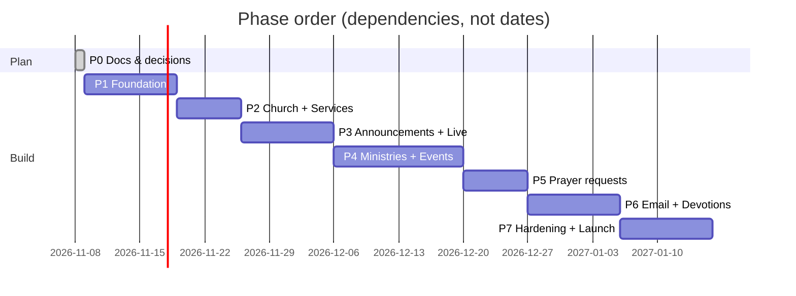

# Development Phases

Docs first, then build in vertical slices (DB → API → public UI → admin UI → tests → docs) so every phase ends with something usable.

**Definition of Done (every phase):**
- [ ] Code merged, `npm run check` clean
- [ ] Tests for the phase pass ([[09-Test-Cases]])
- [ ] Mobile (375 px) checked
- [ ] [[05-API-Reference]], [[04-Data-Model]], [[08-Feature-Configuration-Guide]] updated
- [ ] `CLAUDE.md` Status block updated
- [ ] Deployed to production and smoke-tested

Sizing: **S** ≈ a few sittings, **M** ≈ 1–2 weeks part-time, **L** ≈ 2+ weeks part-time.

---

## Phase 0 — Documentation and decisions (**now**) · S

- [x] Review current repo ([[13-Current-State-Gap-Analysis]])
- [x] Write overview, spec, architecture, data model, API, phases, run guide, config guide, tests, code guide, security
- [ ] **You review and answer** [[14-Decisions-and-Open-Questions]] (especially OQ-01 Rentspot stack, OQ-02, OQ-03)
- [ ] Freeze v1 scope

**Exit:** spec approved, ADR-001 confirmed.

## Phase 1 — Foundation · M

Goal: an empty but real full-stack skeleton deployed to Cloudflare.

- [ ] Spike: verify Cloudflare details (D1, `run_worker_first`, rate limit binding, cron) — record in ADR-001
- [ ] Clean repo: remove `.replit`, `.local/` (add to `.gitignore`, fix the merged `*.tar.gz.local/` line), Replit Vite plugins, `package.json` name → `hope-church`, prune `build.ts`, add real README
- [ ] Replace Express `server/` with Hono `api/`; update `wrangler.jsonc` (main, D1, R2, run_worker_first)
- [ ] Drizzle → D1 (SQLite); migrations folder; seed script
- [ ] Shared Zod schemas + response envelope + error handler
- [ ] Auth: login/logout/me, PBKDF2, cookie session, lockout, roles middleware, audit helper
- [ ] Admin shell UI (login page, layout, nav, route guard) — mobile-friendly
- [ ] `.dev.vars.example`, local run docs verified on a clean Windows machine
- [ ] Test harness: Vitest (API), Testing Library, Playwright; CI workflow
- [ ] Deploy to `church.paul-amancioiii.workers.dev` from a branch

**Exit:** login works in production; `GET /api/public/health` returns OK; tests run in CI.

## Phase 2 — Church setup + Service hours · M

Covers FR-CH, FR-SV. First real data-driven UI.

- [ ] `church_profile` table, seed ("Hope" + placeholders), admin edit form
- [ ] Years serving computed server-side
- [ ] Replace hardcoded About/Footer/Contact/Location text with API data; remove "Faith/Grace" literals
- [ ] Dynamic `document.title`; optional HTML meta rewrite (FR-CH-05)
- [ ] `service_schedules` + exceptions; recurrence engine (weekly, Nth weekday, last) with unit tests
- [ ] Seed Sunday 9–12 and 3–6; admin CRUD + soft delete/restore
- [ ] Public Service Hours cards with next occurrence
- [ ] `GET /api/public/home` (first version)

**Exit:** change the church name in admin → public site updates; add "3rd Tuesday 7–9 PM" → correct next date shown.

## Phase 3 — Announcements + Live stream · L

Covers FR-AN, FR-LS.

- [ ] `announcements` + `media` (R2 upload) + visibility SQL
- [ ] Admin: list with status badges, create/edit, publish, soft delete/restore, preview
- [ ] Public: carousel/list + All/Daily/Weekly/Monthly filter; keep fullscreen theater mode
- [ ] Video URL allowlist + embed conversion
- [ ] `stream_settings`, `stream_replays`; admin Go Live / End
- [ ] Public Watch Online: live player vs countdown vs latest replay; replace hardcoded YouTube URL
- [ ] Polling (every 30 s) for stream state

**Exit:** schedule an announcement for tomorrow → invisible today, visible tomorrow; expired ones vanish; toggling live updates public page.

## Phase 4 — Get involved + Events + registration forms · L

Covers FR-MN, FR-EV.

- [ ] `ministries` CRUD + seeds; public cards
- [ ] `events`, `forms`, `event_registrations`
- [ ] Form builder UI (add/reorder/remove fields, preview)
- [ ] Public event page + dynamic form renderer (shared validation)
- [ ] Capacity/close-date logic, duplicate prevention
- [ ] Admin responses table + CSV export
- [ ] Clone form template

**Exit:** create "Kingdom Family" (with form) and "Christmas Event" (no registration); only the first shows Register; export works.

## Phase 5 — Prayer requests (abuse-safe) · M

Covers FR-PR. Read [[11-Security-and-Abuse-Prevention]] first.

- [ ] Turnstile integration (client + server verify)
- [ ] Rate limit + client hash + blocked clients
- [ ] Screening pipeline (links, contact info, profanity list, repeats, duplicates, crisis terms)
- [ ] Public form replacing the fake contact form; success UX with crisis resources
- [ ] Prayer inbox (role-restricted), statuses, quarantine view, block/spam actions
- [ ] Log-redaction test (no request text in logs)

**Exit:** scripted spam burst gets throttled/quarantined; prayer team sees only clean requests; editor role gets 403.

## Phase 6 — Email updates + Devotions · L

Covers FR-SB.

- [ ] Email provider interface + Resend + console provider; outbox + retries
- [ ] Subscribe → confirm → manage → unsubscribe flow (double opt-in)
- [ ] Devotion admin + scheduling
- [ ] Cron: daily devotion send; announcement/event digest
- [ ] Subscriber admin (list, filter, CSV)
- [ ] Send log, bounce/complaint suppression (S)
- [ ] Sending domain set up (SPF/DKIM) — needs custom domain

**Exit:** a test subscriber confirms, receives the 5 AM PHT devotion, and unsubscribes in one click.

## Phase 7 — Hardening and launch · M

- [ ] Accessibility pass (axe + manual screen reader smoke)
- [ ] Lighthouse mobile ≥ 90 on Home; image optimisation
- [ ] Security review against checklist; CSP headers; dependency audit
- [ ] Backup/export procedure tested ([[12-Deployment-and-Operations]])
- [ ] Content entry with real church data (replace all placeholders)
- [ ] Custom domain (optional), error monitoring
- [ ] Admin training doc / short video; handover checklist
- [ ] Demo + proposal to the church

**Exit:** production checklist in [[12-Deployment-and-Operations]] fully ticked.

## Backlog (post-v1)

TOTP 2FA · Filipino translation · PWA/install prompt · ministry sign-up workflow · calendar `.ics` export · push notifications · native stream (Cloudflare Stream) · giving integration · member login.
