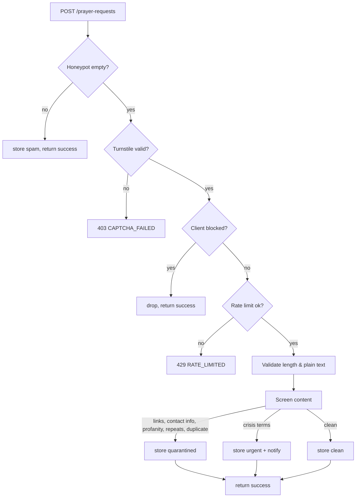

# Security and Abuse Prevention

Focus: the anonymous prayer request form (must not be abusable), subscriptions, registration forms, and the admin area.

> [!info] Not legal advice
> Privacy notes reference the Philippines Data Privacy Act of 2012 (RA 10173). Before launch with the real church, have someone qualified review the privacy notice and retention choices.

## 1. Prayer requests — threat model

| Threat | Example | Control |
|---|---|---|
| Bots / spam floods | Scripted posting of ads | Turnstile token + honeypot field + rate limit |
| Human abuse | Insults, hate, harassment in the "prayer" text | Content screening → quarantine; admin block |
| Doxxing / naming private people | Phone numbers, addresses, accusations | Block contact info patterns; reviewer guidance; "don't share third-party details" hint |
| Malicious links / phishing | URLs in request | Links trigger quarantine; admin UI never auto-links |
| XSS / injection | `<script>` payload | Plain text only, escaped output, Zod length limits, CSP |
| Targeting the prayer team | Mass-submit to hide real ones | Per-client limits, daily caps, quarantine so inbox stays clean |
| De-anonymisation | Admin or attacker links request to a person | No IP/UA/email stored; salted rotating hash only |
| Data leak | Requests visible to editors; logs | Role restriction; log redaction; no analytics on body |
| Crisis content ignored | Someone expresses self-harm | `urgent` flag + crisis-resources message + clear pastoral process |
| Retaliation / enumeration | Probing filter behaviour | Identical success responses for clean and quarantined |

### Layered pipeline

### Rules

- **Client hash** = `HMAC_SHA256(CLIENT_HASH_SECRET, ip + yyyy-mm-dd)`. Rotating daily means abuse can be throttled within a day but long-term tracking isn't possible. IP itself is never written to D1 or logs.
- **Default limits:** 3/hour and 10/day per hash (configurable). Global cap (e.g. 200/day) as a circuit breaker; beyond it requests are queued as quarantined.
- **Screening list** (config, not code): URL, email, phone-number regexes; profanity/slur list (English + Filipino terms, reviewed by the church); character-repeat and ALL-CAPS heuristics; near-duplicate check against last 24 h.
- **Crisis phrases** list is conservative: false positives are acceptable (a human reviews), false negatives are not.
- **No oracle:** quarantined, spam and clean submissions return the same success message so attackers can't tune content.
- **Visibility:** only `prayer_team` and `super_admin`. Not `admin`, not `editor`.
- **Display:** escape everything; quarantine view shows reasons; no auto-linking; no external image loads.
- **Admin actions audited:** status change, release, block, purge (never the text).
- **Retention:** auto-archive 90 d, purge 12 mo (defaults, [[14-Decisions-and-Open-Questions#OQ-09]]).
- **Reviewer guidance (put in the inbox UI):** treat as confidential; relay by summary; don't identify the sender; escalate urgent items to a pastor per the church's care process.

> [!warning] Anonymous means no reply
> Because no contact is collected, the team can't answer a request. Offer an optional "I'd like someone to contact me" checkbox + contact field in a later version only if the church wants it, with explicit consent.

## 2. Email subscriptions

| Threat | Control |
|---|---|
| Subscribing someone else's address | Double opt-in; nothing sent until confirmed |
| Address harvesting | Same response whether or not the email exists |
| Token theft | Random 128-bit+ tokens, **hashed** at rest, single purpose, expire (confirm: 48 h) |
| Spam complaints | One-click unsubscribe in every email + `List-Unsubscribe` header; suppress complaints/bounces |
| Bot signup | Turnstile + rate limit |
| Content injection into emails | Templates escape all variables |

Data minimisation: only email, optional name, topics, consent timestamp. Record consent text version.

## 3. Event registration forms

- Server validates every submission against the stored form definition; unknown keys dropped; sizes limited.
- Turnstile + rate limit + duplicate check.
- CSV export neutralises formula injection (prefix cells starting `= + - @` with `'`).
- Children's events: collect only what's needed; note guardian responsibility in the form text; follow church child-protection policy.

## 4. Admin area

| Control | Detail |
|---|---|
| Passwords | PBKDF2-SHA256 via WebCrypto, per-user salt, high iteration count, min length 12; breached/common password check (S) |
| Sessions | Signed JWT in `HttpOnly; Secure; SameSite=Lax` cookie, short TTL (e.g. 12 h) + sliding refresh |
| CSRF | `SameSite=Lax` + require `Content-Type: application/json` + Origin header check on mutations |
| Lockout | 5 failures → 15 min; login rate limit by client hash |
| 2FA | TOTP in backlog (FR-AD-06) |
| Authorization | Role middleware on every route; tested over the route table |
| Audit | All mutations recorded; super admin only reads |
| Bootstrap | Seed admin from env, forced password change on first login |

## 5. Platform

- **Headers:** `Content-Security-Policy` (default-src 'self'; frame-src limited to YouTube/Facebook/Turnstile; img-src self + R2 domain), `X-Content-Type-Options: nosniff`, `Referrer-Policy: strict-origin-when-cross-origin`, `Permissions-Policy` minimal, HSTS (Cloudflare).
- **Uploads:** type sniffing, size limits, random R2 keys, served with correct `Content-Type`; no SVG uploads (script risk) unless sanitised.
- **Embeds:** iframe URLs are *built* from an ID/channel by trusted code, not pasted raw.
- **Secrets:** `wrangler secret`, never in repo or client bundle. Rotate if leaked.
- **Dependencies:** `npm audit` in CI; pin Actions; review new packages.
- **Errors:** generic messages to clients; details only in server logs (without personal data).
- **Backups:** see [[12-Deployment-and-Operations]].

## 6. Privacy checklist (RA 10173 oriented)

- [ ] Privacy notice linked in the footer and next to each form (what, why, how long, who sees it, how to withdraw)
- [ ] Consent captured for subscriptions and registrations (timestamp + notice version)
- [ ] Purpose limitation: data used only for stated purpose
- [ ] Retention periods set and automated ([[04-Data-Model#Retention defaults (configurable)]])
- [ ] Access/erasure request procedure documented (super admin purge, audited)
- [ ] Prayer requests treated as **sensitive personal information** (they can reveal health/religion): restricted access, minimal retention
- [ ] Breach response contact and steps written down
- [ ] Church designates a data contact person

## 7. Documented exception to "always soft delete"

A **privacy purge** (erasure request, retention expiry) physically removes subscriber or prayer request rows. Only `super_admin`, only through `api/services/privacy-purge.ts`, always writes an audit entry (without content). Everything else is soft delete.

## 8. Pre-launch security checklist

- [ ] All admin routes 401 without cookie; role matrix tests green ([[09-Test-Cases#Auth, roles, audit, soft delete (cross-cutting)]])
- [ ] Prayer abuse simulation: 100 scripted posts → throttled/quarantined, inbox clean
- [ ] XSS probe strings rendered inert in every text field
- [ ] No request text/emails/tokens in logs (grep production logs after a test)
- [ ] CSP active, no inline script violations
- [ ] Secrets only in Cloudflare; `.dev.vars` ignored by git
- [ ] Seed admin password changed; unused accounts deactivated
- [ ] Dependency audit reviewed
